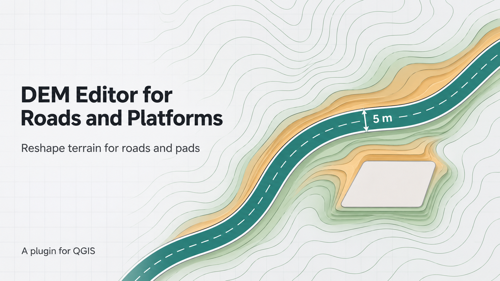
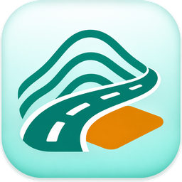

<h1 align="center">DEM Editor for Roads and Platforms</h1>

<p align="center">
  
</p>

<p align="center">
  
</p>

<p align="center">
  <strong>Cut a road corridor or a level platform into a DEM and blend it into the surrounding ground.</strong><br>
  The result is a new GeoTIFF. Your original DEM stays unchanged.
</p>

<p align="center">
  
  
  
  <a href="LICENSE"></a>
</p>

Site planners, road designers and GIS analysts often need a quick terrain model that shows a road or a building pad cut into the ground. DEM Editor for Roads and Platforms edits a DEM along a line you draw or inside polygons you select. It flattens the corridor, follows the terrain along the road, and blends the edit into the ground around it.

What you can do:

- Draw a centerline and set a buffer distance on the left, right, or both sides.
- Create a road surface that is flat across its width and follows a smoothed elevation profile along its length.
- Level a corridor or a polygon area to an elevation you enter, or to the mean or median elevation along its edge.
- Blend the edited surface into the surrounding terrain over a transition width you choose.
- Read the number of changed pixels and the maximum cut and fill when the edit finishes.

**The plugin writes a new GeoTIFF and a corridor shapefile. It never modifies the source DEM.**

---

## Features

| Feature | What it does |
|---|---|
| Road mode | Uses the median valid DEM elevation across the buffer at each station, then smooths the profile along the road. This tends to balance cut and fill in the sampled corridor. |
| Flat corridor mode | Sets the whole corridor to one elevation. The elevation is an entered value, or the median or mean elevation of the corridor edge. |
| Corridor sources | Digitize a new centerline, use selected polygon features, or use all features in a polygon layer. Polygons support Flat mode only. |
| Outside transition | Lowers ground above the edited surface and raises ground below it. The default width is 20 m. Zero gives a sharp edge. |
| Background task | The edit runs as a QGIS task with progress and a cancel button. |
| Repeat edits | While the digitizing tool stays active, each new line edits the result of the previous run, so several roads accumulate in one terrain. |

---

## Getting started

1. Download the plugin ZIP.
2. In QGIS, open **Plugins > Manage and Install Plugins > Install from ZIP**.
3. Select the ZIP and enable **DEM Editor for Roads and Platforms**.

The plugin needs QGIS 3.34 or newer. It also needs the GDAL, NumPy and SciPy Python modules in the QGIS Python environment.

---

## How to use it

1. Load a single-band DEM raster. Set the QGIS project to a projected CRS with meter units.
2. Start the plugin from the toolbar or the plugin menu.
3. Choose the corridor source:
   - **Digitize a new centerline.** Accept the dialog, then click vertices on the canvas. Double-click, press Enter, or right-click to finish. Escape cancels the current line. A second Escape exits the tool.
   - **Use selected polygon features.** Choose the polygon layer. Select **Selected features only** or **All features in this layer**. The dialog shows the feature counts.
4. Choose the edit mode, the DEM, and the output paths. The paths default to the DEM folder.
5. Run the edit and wait for the result message.

When you buffer both sides of a line, the distance applies to each side. A 5 m buffer on both sides gives a road about 10 m wide, plus the outside transition.

---

## Where results go

| Output | Details |
|---|---|
| Edited DEM | `<dem>_road_edited.tif` by default. It keeps the CRS, extent, resolution and pixel type of the source. |
| Corridor shapefile | `<dem>_road_corridor.shp` by default, in the DEM CRS. It holds one corridor with the attributes `mode`, `dist_m`, `side`, `stat`, `source`, `dem_path` and `edit_date`. |
| Project layers | The plugin adds both outputs to the QGIS project when the edit finishes. |

If a chosen path already exists, the plugin adds a numeric suffix (`_2`, `_3`) so no earlier result is overwritten.

---

## Troubleshooting

| Problem | What to do |
|---|---|
| A message asks for a projected CRS | Set the project CRS to a projected system with meter units. Reproject a geographic DEM before you edit it. |
| The result reports zero changed pixels | Check the DEM, the corridor, the resolution, and the elevation settings. |
| The run is refused because of invalid geometry | Sharp bends can create self-intersecting buffers. Smooth the line or use fewer sharp vertices. |
| The plugin does not load | Check that GDAL, NumPy and SciPy exist in the QGIS Python environment. |

---

## Limits

- The DEM must be a file-based, single-band raster such as a GeoTIFF.
- A DEM in a different CRS from the project is supported. The plugin transforms the corridor.
- NoData pixels inside the corridor stay untouched. The result message reports them.
- Road mode needs a digitized centerline. A polygon does not define a reliable longitudinal axis.
- The output keeps the source resolution and data type. A buffer narrower than one pixel may contain no pixel center. An integer DEM rounds elevations.
- The outside transition is a smooth visual blend. It is not an engineered slope with a specified grade, and it may extend beyond the buffer or polygon. Review the result separately for engineering design.
- The plugin has no undo for a raster edit and no in-place overwrite.
- The plugin passes tests on QGIS 4.2.3. QGIS 3.x is untested.

---

## For developers

Build and validate the plugin ZIP:

```bash
python3 scripts/package_plugin.py --output dist/DEM_Editor_for_Road_and_Platform.zip
python3 scripts/validate_plugin.py dist/DEM_Editor_for_Road_and_Platform.zip
```

Run the tests with the real QGIS bindings:

```bash
QT_QPA_PLATFORM=offscreen PYTHONPATH=/usr/share/qgis/python:/usr/lib/python3/dist-packages /usr/bin/python3 -m pytest -q tests
```

Release notes are in [CHANGELOG.md](CHANGELOG.md).

---

## Contributing

Open an issue at [the issue tracker](https://github.com/vchhikara/DEM-Editor-for-Road-and-Platform/issues) to report a bug or suggest a change.

Copyright (c) Vipul Chhikara. Licensed under the GNU General Public License, version 3 or (at your option) any later version. See [LICENSE](LICENSE).
